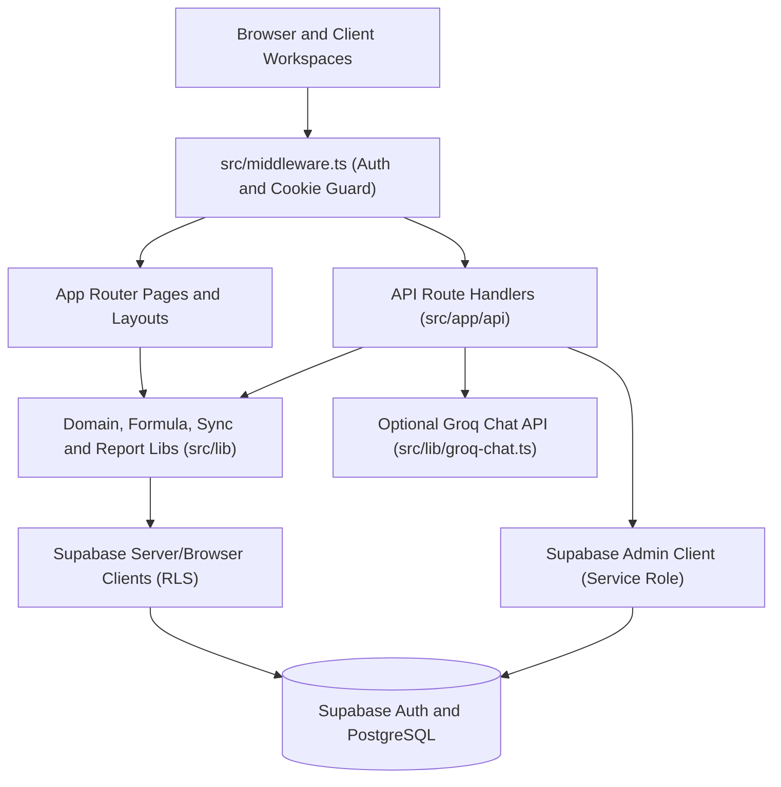

# DA-PCC MFP

DA-PCC MFP (`mfp-web`) is a Department of Agriculture – Philippine Carabao Center (DA-PCC) web application for managing milk feeding masterlists, recording procurement and delivery data, and monitoring program performance across PCC centers, dairy cooperatives, Schools Division Offices (SDOs), and beneficiary drop-off points.

The application serves PIMD / head-office administrators (`super_admin`), center encoders (`encoder`), and viewers (`viewer`). Its main program views are **School-Based Feeding Program (SBFP / DepEd)** and **Program Monitoring** across **DSWD**, **LDS**, **LGU**, and **Others**, together with the unified MFP masterlist and spreadsheet/narrative reporting.

This guide describes the implementation in this repository. Routes, pages, SQL migrations, and Node tests exist for the modules below; their presence does not by itself establish production readiness or a complete standalone schema baseline. Historical utility scripts and planning notes can reflect earlier data states, so consult the linked source, migrations, and tests when making changes.

## Contents

- [Technology stack](#technology-stack)
- [Architecture overview](#architecture-overview)
- [Project directory structure](#project-directory-structure)
- [Core features and modules](#core-features-and-modules)
- [Database and data management](#database-and-data-management)
- [Installation and local development](#installation-and-local-development)
- [Configuration](#configuration)
- [Development workflow and conventions](#development-workflow-and-conventions)
- [Testing](#testing)
- [Deployment overview](#deployment-overview)
- [Troubleshooting](#troubleshooting)
- [Additional documentation](#additional-documentation)
- [Verification limits and known gaps](#verification-limits-and-known-gaps)

## Technology stack

Versions below are recorded in [package.json](package.json) and [package-lock.json](package-lock.json). Runtime requirements are discussed under installation.

| Area                         | Implementation                                                                                                                                    |
| ---------------------------- | ------------------------------------------------------------------------------------------------------------------------------------------------- |
| Framework & runtime          | Next.js `16.3.0` (App Router), React `19.2.8` & React DOM `19.2.8`, TypeScript `5.9.3`                                                            |
| Authentication & database    | Supabase PostgreSQL, `@supabase/supabase-js` `2.112.3`, `@supabase/ssr` `0.12.4`; direct PostgreSQL utility scripts use `pg` `8.23.0`            |
| Styling & UI                 | Tailwind CSS `4.3.3` (`@tailwindcss/postcss`), `clsx` `2.1.1`, `tailwind-merge` `3.6.0`, `lucide-react` `1.31.0`, CSS Modules where needed        |
| Charts & visualizations      | Recharts `3.10.1` and custom SVG/report chart components ([SbfpReportGraphs.tsx](src/components/SbfpReportGraphs.tsx), [SbfpReportChartVisuals.tsx](src/components/SbfpReportChartVisuals.tsx)) |
| State & request caching      | React Server Components, React 19 `cache()` per-request session memoization ([auth-session.ts](src/lib/auth-session.ts)), client state, URL query params |
| Imports, exports & documents | `xlsx` `0.18.5`, `xlsx-js-style` `1.2.0`, `papaparse` `5.6.0`, `fflate` `0.8.3` (`.docx` packaging in [sbfp-progress-docx.ts](src/lib/sbfp-progress-docx.ts)), `html2pdf.js` `0.14.0`, `html-to-image` `1.11.13` |
| Dates & formatting           | `date-fns` `4.4.0`                                                                                                                                |
| AI analysis assistant        | Deterministic local KPI/column analytics ([mfp-analytics.ts](src/lib/mfp-analytics.ts), [mfp-column-analytics.ts](src/lib/mfp-column-analytics.ts)) with optional Groq chat explanations ([groq-chat.ts](src/lib/groq-chat.ts)) |
| Tests & quality tools        | Node.js built-in test runner (`node:test`) with TypeScript VM loader ([load-typescript.mjs](tests/helpers/load-typescript.mjs)), ESLint `9.39.5` (`eslint-config-next` `16.3.0`), `tsc --noEmit` |
| Deployment & process control | Vercel Git integration for `main` deployments; optional manual PCC server workflow ([deploy-pcc-server.yml](.github/workflows/deploy-pcc-server.yml), [pcc-server-bootstrap.sh](scripts/pcc-server-bootstrap.sh)) |

See [package.json](package.json) for npm scripts and dependency declarations. A package being installed does not mean every module exercises all of its capabilities.

## Architecture overview

This is a Next.js App Router application backed by Supabase Auth and PostgreSQL. Server Components and authenticated Route Handlers handle session resolution, privileged writes, and AI endpoints, while interactive data-entry workspaces and spreadsheet reports run in Client Components.



A typical request follows this path:

1. [src/middleware.ts](src/middleware.ts) allows public `/` and `/api/health`, redirects signed-in users away from `/login` to `/dashboard`, and redirects unauthenticated requests to `/login` while refreshing Supabase SSR auth cookies.
2. [src/app/(app)/layout.tsx](src/app/%28app%29/layout.tsx) calls `getCurrentUser()` in [src/lib/auth-session.ts](src/lib/auth-session.ts) (memoized per HTTP request via React `cache()`) to load the user's `profiles` record (`role`, `center`, `full_name`) and renders [AppShell](src/components/AppShell.tsx) and [Sidebar](src/components/Sidebar.tsx).
3. Server pages and client workspaces read and update operational tables via [src/lib/supabase/server.ts](src/lib/supabase/server.ts) and [src/lib/supabase/client.ts](src/lib/supabase/client.ts), using range pagination helpers ([src/lib/supabase-paginate.ts](src/lib/supabase-paginate.ts)) to avoid PostgREST's 1,000-row response cap.
4. Cross-table masterlist synchronization and privileged operations run through authenticated Route Handlers under `src/app/api/` — such as [src/app/api/sbfp/sync-dropoff/route.ts](src/app/api/sbfp/sync-dropoff/route.ts), [src/app/api/monitoring/sync-dropoff/route.ts](src/app/api/monitoring/sync-dropoff/route.ts), and [src/app/api/users/route.ts](src/app/api/users/route.ts) — which check the caller's session before executing service-role writes through [src/lib/supabase/admin.ts](src/lib/supabase/admin.ts).
5. Domain formulas, milk volume conversions, school-year mappings, payment summaries, and report aggregations live in pure TypeScript modules under `src/lib/`.

## Project directory structure

```text
.
├── .github/
│   └── workflows/
│       └── deploy-pcc-server.yml      # Manual workflow_dispatch deploy to PCC server (disabled on push)
├── docs/
│   ├── adr/                           # Architectural Decision Records template and index
│   └── agents/                        # Domain glossary, workflow, and issue-tracker rules
├── scripts/                           # Server bootstrap, seeding, resync, and cleanup scripts
├── src/
│   ├── app/
│   │   ├── (app)/                     # Authenticated application shell and pages
│   │   │   ├── centers/               # PCC center directory and per-center views
│   │   │   ├── dashboard/             # Program KPI overview dashboard
│   │   │   ├── data/                  # Unified MFP masterlist CRUD and bulk edit
│   │   │   ├── monitoring/[program]/  # Shared dynamic route for DSWD, LDS, LGU & Others
│   │   │   │   ├── center/[center]/   # Per-center monitoring workspace & monthly hubs
│   │   │   │   ├── overall/           # National / overall monitoring dashboard
│   │   │   │   └── page.tsx           # Program index (serves /monitoring/dswd, /lds, /lgu, /others)
│   │   │   ├── reports/               # Program-specific reports and exports
│   │   │   │   ├── pimd/              # Cross-program PIMD Factsheet (/reports/pimd)
│   │   │   │   ├── sbfp-narrative/    # SBFP (DepEd) 9-tab narrative & Senate report
│   │   │   │   ├── dswd-narrative/    # DSWD spreadsheet & distribution report
│   │   │   │   ├── lds-narrative/     # LDS spreadsheet & distribution report
│   │   │   │   ├── lgu-narrative/     # LGU spreadsheet & distribution report
│   │   │   │   ├── others-narrative/  # Others spreadsheet & distribution report
│   │   │   │   ├── packs/             # Milk packs breakdown report
│   │   │   │   ├── summary-deped/     # DepEd program summary report
│   │   │   │   ├── summary-dswd/      # DSWD program summary report
│   │   │   │   └── summary-lds/       # LDS program summary report
│   │   │   ├── sbfp/                  # SBFP (DepEd) dedicated workspace & sub-modules
│   │   │   │   ├── activities/        # SBFP implementation activities checklist
│   │   │   │   ├── budget/            # SBFP budget & capacity allocation
│   │   │   │   ├── center/[center]/   # Per-center SBFP school-year workspace
│   │   │   │   ├── nhq/               # National Headquarters (NHQ) SBFP view
│   │   │   │   ├── overall/           # Overall SBFP monitoring dashboard
│   │   │   │   └── summary/           # SBFP summary view
│   │   │   ├── sbfp-data/             # SBFP masterlist views
│   │   │   └── users/                 # User account management (super_admin)
│   │   ├── api/
│   │   │   ├── admin/                 # School-year administration endpoints
│   │   │   ├── ai/                    # MFP & SBFP analytics/chat Route Handlers
│   │   │   ├── health/                # Runtime database readiness probe
│   │   │   ├── monitoring/            # Program drop-off & division sync handlers
│   │   │   ├── sbfp/                  # SBFP drop-off sync, finance, major targets APIs
│   │   │   ├── users/                 # Supabase Admin user provisioning/deletion APIs
│   │   │   └── *migration*/           # Legacy manual migration helper routes
│   │   ├── login/                     # Public sign-in page
│   │   ├── layout.tsx                 # Root HTML shell and metadata
│   │   └── page.tsx                   # Public landing page
│   ├── components/
│   │   ├── dashboard/                 # DashboardOverview KPI & chart components
│   │   ├── loading/                   # Async feedback and spinner components
│   │   ├── reports/spreadsheet/       # Shared spreadsheet styling, tabs, and export utils
│   │   └── *.tsx                      # Workspaces, tables, filters, charts, AI panels
│   ├── lib/
│   │   ├── supabase/                  # Browser, server SSR, and service-role clients
│   │   └── *.ts                       # Domain formulas, sync logic, report math, types
│   └── middleware.ts                  # Session refresh and route protection
├── supabase/
│   ├── migrations/                    # Timestamped SQL schema, index, and seed migrations
│   └── pending/                       # Unmerged/manual SQL scripts awaiting review
├── tests/
│   ├── helpers/load-typescript.mjs    # On-the-fly TS/TSX compiler loader for node:test
│   ├── sql/                           # SQL behavior verification scripts
│   └── *.test.mjs                     # Node unit and component/API tests
├── AGENTS.md                          # Repository agent rules and Next.js notice
├── CONTEXT.md                         # Domain vocabulary, routes, and known uncertainties
├── eslint.config.mjs                  # ESLint flat config (Next core-web-vitals + TS)
├── next.config.ts                     # Next.js configuration
├── package.json                       # Dependencies and build/lint/dev scripts
├── postcss.config.mjs                 # PostCSS Tailwind v4 plugin configuration
└── tsconfig.json                      # TypeScript compiler config (`@/*` -> `./src/*`)
```

### Program route and data map

`sbfp/` has its own dedicated folder because DepEd SBFP uses school years, SDOs, PPMP items, staff hiring, and `sbfp_*` tables, whereas DSWD, LDS, LGU, and Others share the Next.js dynamic route `src/app/(app)/monitoring/[program]/` (configured in [monitoring-programs.ts](src/lib/monitoring-programs.ts)):

| Program       | Monitoring URL        | Report URL(s)                                                                                                                                                           | Backing Supabase tables                                                                              |
| ------------- | --------------------- | ----------------------------------------------------------------------------------------------------------------------------------------------------------------------- | ---------------------------------------------------------------------------------------------------- |
| SBFP (DepEd)  | `/sbfp`, `/sbfp-data` | `/reports/sbfp-narrative`, `/reports/summary-deped` ([sbfp-narrative](src/app/%28app%29/reports/sbfp-narrative/page.tsx), [summary-deped](src/app/%28app%29/reports/summary-deped/page.tsx)) | `sbfp_data`, `sbfp_dropoff_points`, `sbfp_school_years`, `sbfp_budget`, `sbfp_ppmp_items`, `mfp_data` |
| DSWD          | `/monitoring/dswd`    | `/reports/dswd-narrative`, `/reports/summary-dswd` ([dswd-narrative](src/app/%28app%29/reports/dswd-narrative/page.tsx), [summary-dswd](src/app/%28app%29/reports/summary-dswd/page.tsx))     | `mfp_program_procurement`, `mfp_program_dropoffs`, `mfp_program_months`, `mfp_data`                  |
| LDS           | `/monitoring/lds`     | `/reports/lds-narrative`, `/reports/summary-lds` ([lds-narrative](src/app/%28app%29/reports/lds-narrative/page.tsx), [summary-lds](src/app/%28app%29/reports/summary-lds/page.tsx))         | `mfp_program_procurement`, `mfp_program_dropoffs`, `mfp_program_months`, `mfp_data`                  |
| LGU           | `/monitoring/lgu`     | `/reports/lgu-narrative` ([lgu-narrative](src/app/%28app%29/reports/lgu-narrative/page.tsx))                                                                            | `mfp_program_procurement`, `mfp_program_dropoffs`, `mfp_program_months`, `mfp_data`                  |
| Others        | `/monitoring/others`  | `/reports/others-narrative`, `/reports/pimd` ([others-narrative](src/app/%28app%29/reports/others-narrative/page.tsx), [pimd](src/app/%28app%29/reports/pimd/page.tsx))                       | `mfp_program_procurement`, `mfp_program_dropoffs`, `mfp_program_months`, `mfp_data`                  |

## Core features and modules

| Module                                    | Responsibilities and data                                                                                                                     | Starting points                                                                                                                                                                                             |
| ----------------------------------------- | --------------------------------------------------------------------------------------------------------------------------------------------- | ----------------------------------------------------------------------------------------------------------------------------------------------------------------------------------------------------------- |
| Landing and dashboard                     | Public program overview (`/`), authenticated KPI dashboard, funder/year/center filters, commitment vs. accomplishment metrics                 | [page.tsx](src/app/page.tsx), [dashboard/page.tsx](src/app/%28app%29/dashboard/page.tsx), [DashboardOverview.tsx](src/components/dashboard/DashboardOverview.tsx), [dashboard-stats.ts](src/lib/dashboard-stats.ts) |
| MFP masterlist (`mfp_data`)               | Beneficiary and school masterlist CRUD, single-row and bulk editing, milk formulation/volume calculations, CSV export, column analytics       | [data/page.tsx](src/app/%28app%29/data/page.tsx), [DataTable.tsx](src/components/DataTable.tsx), [mfp-formulas.ts](src/lib/mfp-formulas.ts), [mfp-list-data.ts](src/lib/mfp-list-data.ts), [MfpAiAgent.tsx](src/components/MfpAiAgent.tsx) |
| Centers and activity tracking             | 13-center PCC directory, per-center masterlist views, recent encoder activity timelines across operational tables and `mfp_center_activity`   | [centers/page.tsx](src/app/%28app%29/centers/page.tsx), [center-activity.ts](src/lib/center-activity.ts), [center-aliases.ts](src/lib/center-aliases.ts)                                                   |
| SBFP (DepEd) workspace                    | School-year hubs, SDO procurement and monthly/snapshot pack deliveries, school drop-off points, feeding days, pack finances, PPMP, hiring     | [sbfp/page.tsx](src/app/%28app%29/sbfp/page.tsx), [sbfp-data/page.tsx](src/app/%28app%29/sbfp-data/page.tsx), [SbfpCenterWorkspace.tsx](src/components/SbfpCenterWorkspace.tsx), [SbfpDropoffTable.tsx](src/components/SbfpDropoffTable.tsx), [sbfp-compute.ts](src/lib/sbfp-compute.ts) |
| Program monitoring (DSWD, LDS, LGU, Others) | Multi-program year/month hubs, procurement contracts, payment entries, drop-off tables, overall and per-center monitoring dashboards          | [monitoring/page.tsx](src/app/%28app%29/monitoring/%5Bprogram%5D/page.tsx), [MfpProgramWorkspace.tsx](src/components/MfpProgramWorkspace.tsx), [ProgramProcurementTable.tsx](src/components/ProgramProcurementTable.tsx), [monitoring-programs.ts](src/lib/monitoring-programs.ts) |
| Reports, spreadsheets and exports         | Factsheet (`/reports/pimd`), SBFP narrative/Senate report, DSWD/LDS/LGU/Others reports, summary views, graph mode, CSV, `.xlsx`, `.docx`, PDF | [sbfp-narrative/page.tsx](src/app/%28app%29/reports/sbfp-narrative/page.tsx), [ProgramSpreadsheetReport.tsx](src/components/ProgramSpreadsheetReport.tsx), [sbfp-report-sync.ts](src/lib/sbfp-report-sync.ts), [sbfp-progress-docx.ts](src/lib/sbfp-progress-docx.ts) |
| AI reporting & data assistants            | Scope-aware exact counts, totals, and breakdowns with optional Groq LLM explanations and byte-budgeted context                                | [SbfpAiAgent.tsx](src/components/SbfpAiAgent.tsx), [MfpAiAgent.tsx](src/components/MfpAiAgent.tsx), [api/ai/chat/route.ts](src/app/api/ai/chat/route.ts), [api/ai/mfp/route.ts](src/app/api/ai/mfp/route.ts), [groq-chat.ts](src/lib/groq-chat.ts) |
| User accounts and health                  | `super_admin` user provisioning and deletion via Supabase Admin API, role/center assignment, `/api/health` readiness check                    | [users/page.tsx](src/app/%28app%29/users/page.tsx), [api/users/route.ts](src/app/api/users/route.ts), [api/health/route.ts](src/app/api/health/route.ts)                                                |

### Drop-off to masterlist synchronization

Operational drop-off records can automatically synchronize into the unified `mfp_data` masterlist so center encoders do not have to double-encode school or beneficiary deliveries:

```text
sbfp_data / sbfp_dropoff_points ──(/api/sbfp/sync-dropoff)──────▶ mfp_data (source_dropoff_id)
mfp_program_procurement / dropoffs ──(/api/monitoring/sync-dropoff)──▶ mfp_data (source_program_dropoff_id)
```

- [src/lib/sbfp-dropoff-sync.ts](src/lib/sbfp-dropoff-sync.ts) and [src/app/api/sbfp/sync-dropoff/route.ts](src/app/api/sbfp/sync-dropoff/route.ts) sync included SBFP schools (`include_in_masterlist`), cascade SDO renames and supplier/price updates, recalculate delivery figures, and unlink removed rows.
- [src/lib/program-dropoff-sync.ts](src/lib/program-dropoff-sync.ts) and [src/app/api/monitoring/sync-dropoff/route.ts](src/app/api/monitoring/sync-dropoff/route.ts) perform the equivalent sync, cascade, and delete-cascade operations for DSWD, LDS, LGU, and Others monitoring records.

## Database and data management

### Main entities and relationships

The system connects PCC centers and dairy cooperatives to program-specific procurement/drop-off records and the unified masterlist:

```text
PCC Centers & Cooperatives ──▶ SDO / Program Procurement ──▶ Drop-off Points ──▶ Unified mfp_data Masterlist
```

| Entities / tables                                                                                                                               | Relationship and purpose                                                                                                                                      |
| ----------------------------------------------------------------------------------------------------------------------------------------------- | ------------------------------------------------------------------------------------------------------------------------------------------------------------- |
| `profiles`                                                                                                                                      | User account metadata (`id`, `email`, `full_name`, `role`, `center`) linked to `auth.users`.                                                                  |
| `cooperatives`                                                                                                                                  | Dairy cooperatives (`name`, `short_name`, `region`, `is_active`) referenced as `supplier_id` on masterlist and SBFP contracts.                                |
| `mfp_data`                                                                                                                                      | Unified MFP beneficiary/school masterlist across funders (`DepEd`, `DSWD`, `LDS`, `LGU`, others), milk quantities, costs, dates, and optional sync foreign keys. |
| `sbfp_data`, `sbfp_school_years`, `sbfp_dropoff_points`                                                                                         | SBFP school years, SDO-level procurement/monthly & snapshot delivery records, and school-level drop-off allocations with feeding days and computed finances.   |
| `sbfp_monitoring`, `sbfp_summary`, `sbfp_budget`, `sbfp_activities`, `sbfp_ppmp_items`, `sbfp_staff_hiring`, `sbfp_major_accomplishment_targets`, `sbfp_financial_accomplishment` | Supporting SBFP monitoring snapshots, center budgets/capacities, activity checklists, PPMP/hiring tables, major accomplishment targets, and financial tracking. |
| `mfp_program_procurement`, `mfp_program_dropoffs`, `mfp_program_months`                                                                         | Multi-program monitoring (`dswd`, `lds`, `lgu`, `others`) procurement contracts, payment entries, drop-off points, and active reporting months.               |
| `mfp_center_activity`                                                                                                                           | Explicit center activity audit events combined with `created_at`/`updated_at` timestamps across operational tables in [center-activity.ts](src/lib/center-activity.ts). |
| `summary_lds`, `summary_deped_sbfp`, `summary_dswd_sfp`, `beneficiaries_by_region_year`                                                         | Legacy SQL reporting views hardened with `security_invoker = true` in [20260914140000_security_invoker_summary_views.sql](supabase/migrations/20260914140000_security_invoker_summary_views.sql). |

Incremental schema changes live in [supabase/migrations](supabase/migrations) starting from `20260824103800_create_sbfp_data.sql`. Foundational tables (`profiles`, `cooperatives`, and the base `mfp_data` table) pre-date the checked-in migration history, and [supabase/pending](supabase/pending) holds SQL scripts not yet merged into the timestamped migration stream.

### Access and data isolation

- User roles stored in `public.profiles` are `super_admin` (head-office / PIMD full access across all centers and `/users`), `encoder` (center-scoped data entry), and `viewer` (read-only reporting access; summary DepEd/DSWD/LDS sidebar links are hidden for viewers in [Sidebar.tsx](src/components/Sidebar.tsx)).
- Canonical centers are defined in [src/lib/types.ts](src/lib/types.ts) (`MMSU`, `CSU`, `CMU`, `DMMMSU`, `LCSF`, `CLSU`, `MLPC`, `UPLB`, `USF`, `USM`, `VSU`, `WVSU`, `NHQGP (NIZ)`), with alias normalization (such as `NHQ` ↔ `NHQGP (NIZ)`) in [src/lib/center-aliases.ts](src/lib/center-aliases.ts).
- Server layouts, pages, and report views lock `encoder` users to their assigned `center`, while [src/app/api/users/route.ts](src/app/api/users/route.ts) checks `profile?.role === 'super_admin'` before calling `supabaseAdmin`.
- Several Supabase migrations configure permissive `authenticated` Row Level Security (RLS) policies and delegate cross-table writes to service-role API routes. Always enforce session and center-scope checks on the server when adding or editing Route Handlers.

### Migrations and data utilities

Apply SQL files in [supabase/migrations](supabase/migrations) in chronological order through the Supabase CLI or SQL Editor, and review [supabase/pending](supabase/pending) before executing any pending SQL against a target database.

The `scripts/` directory contains one-off seeding, backfill, resync, and cleanup utilities (such as `seed-*`, `resync-*`, and `purge-*`). Treat these as operational maintenance scripts: inspect them carefully before running, and never execute `purge*` or `seed*` scripts against a production database unintentionally.

## Installation and local development

These commands are verified against [package.json](package.json) and repository scripts. A fresh clean-machine Supabase provisioning run was not executed as part of this documentation update.

### 1. Prerequisites and checkout

- **Node.js 20+** (Node 20.x matches [scripts/pcc-server-bootstrap.sh](scripts/pcc-server-bootstrap.sh)) and npm.
- A **Supabase** project (cloud or local Supabase CLI) with Auth and PostgreSQL enabled.

Replace `<repository-url>` with the repository's clone URL:

```bash
git clone <repository-url> mfp-web
cd mfp-web
npm ci
```

### 2. Configure environment variables

Create `.env.local` in the repository root with your Supabase credentials (use placeholders below and keep real keys out of version control):

```dotenv
NEXT_PUBLIC_SUPABASE_URL=<your-supabase-project-url>
NEXT_PUBLIC_SUPABASE_ANON_KEY=<your-supabase-anon-key>
SUPABASE_SERVICE_ROLE_KEY=<your-supabase-service-role-key>

# Optional: enables AI narrative explanations in MfpAiAgent / SbfpAiAgent
GROQ_API_KEY=<your-groq-api-key>

# Optional: used only by direct PostgreSQL maintenance scripts in scripts/
DATABASE_URL=<your-postgres-connection-string>
```

### 3. Initialize database schema

Because `profiles`, `cooperatives`, and the base `mfp_data` table pre-date [supabase/migrations](supabase/migrations), ensure those base tables exist in your target Supabase project first, then apply the timestamped SQL migrations in [supabase/migrations](supabase/migrations) in chronological order using the Supabase CLI (`supabase db push`) or the Supabase SQL Editor.

### 4. Bootstrap the first administrator

Public user registration is not exposed in the UI; [src/middleware.ts](src/middleware.ts) routes unauthenticated traffic to `/login`. On a new environment:

1. Create your initial administrator user in the Supabase Dashboard (**Authentication → Users**) or via a one-off script configured with environment variables.
2. Insert or update the corresponding row in `public.profiles` with `role = 'super_admin'` and `email` / `full_name`.
3. Sign in at `/login` and manage subsequent `super_admin`, `encoder`, and `viewer` accounts through `/users`.

### 5. Start the development server

```bash
npm run dev
```

Open `http://localhost:3000`. To verify a production build locally:

```bash
npm run build
npm run start
```

## Configuration

| Configuration                                                                                               | Purpose                                                                                                                  |
| ----------------------------------------------------------------------------------------------------------- | ------------------------------------------------------------------------------------------------------------------------ |
| `.env.local`                                                                                                | `NEXT_PUBLIC_SUPABASE_URL`, `NEXT_PUBLIC_SUPABASE_ANON_KEY`, `SUPABASE_SERVICE_ROLE_KEY`, optional `GROQ_API_KEY`, optional `DATABASE_URL` / `SUPABASE_DB_URL` |
| [next.config.ts](next.config.ts), [tsconfig.json](tsconfig.json)                                            | Next.js configuration and strict TypeScript compiler settings (`@/*` path alias mapped to `./src/*`)                     |
| [eslint.config.mjs](eslint.config.mjs), [postcss.config.mjs](postcss.config.mjs)                            | ESLint flat config (`eslint-config-next/core-web-vitals` + `typescript`) and Tailwind CSS v4 PostCSS integration         |
| [src/middleware.ts](src/middleware.ts)                                                                      | Public routes (`/`, `/api/health`), `/login` redirect handling, and Supabase SSR cookie refresh                          |
| [src/lib/types.ts](src/lib/types.ts), [src/lib/center-aliases.ts](src/lib/center-aliases.ts)                | Canonical `PCC_CENTERS`, `REGIONS`, `MODES_OF_PROCUREMENT`, milk types, and center code alias normalization              |
| [src/lib/monitoring-programs.ts](src/lib/monitoring-programs.ts), [src/lib/sbfp-pack-price.ts](src/lib/sbfp-pack-price.ts), [src/lib/mfp-formulas.ts](src/lib/mfp-formulas.ts) | Program definitions (`dswd`, `lds`, `lgu`, `others`), SBFP pack pricing, and milk volume/formulation conversions         |

`NEXT_PUBLIC_*` environment variables are compiled into the browser bundle during `npm run build`. Keep `SUPABASE_SERVICE_ROLE_KEY`, `GROQ_API_KEY`, and database connection strings strictly server-side.

## Development workflow and conventions

### Extending a feature

1. Read [CONTEXT.md](CONTEXT.md) and [docs/agents/domain.md](docs/agents/domain.md) before modifying unfamiliar areas so domain terms (*Center*, *Beneficiary*, *SDO*, *Drop-off*, *PIMD*, *Encoder*) stay consistent across UI and code.
2. Paginate Supabase queries that can exceed 1,000 rows using [src/lib/supabase-paginate.ts](src/lib/supabase-paginate.ts) instead of assuming `.select('*')` returns an entire table.
3. Enforce authentication and center/role checks on server pages and Route Handlers in `src/app/api/`, especially when touching `supabaseAdmin`.
4. Keep pure calculation, classification, and aggregation logic in `src/lib/` so it can be unit-tested with `node:test`.
5. Add new schema changes as timestamped SQL files under [supabase/migrations](supabase/migrations) rather than editing already-applied migrations.
6. Leave the Next.js-managed `<!-- BEGIN:nextjs-agent-rules -->` block in [AGENTS.md](AGENTS.md) intact (`next dev` regenerates it automatically).

### Quality commands and CI

| Command                         | Purpose                                                               |
| ------------------------------- | --------------------------------------------------------------------- |
| `npm run dev`                   | Start the local Next.js development server on `http://localhost:3000` |
| `npm run lint`                  | Run ESLint across the repository                                      |
| `npx tsc --noEmit`              | Run TypeScript type-checking without emitting files                   |
| `node --test tests/*.test.mjs`  | Run the Node.js unit/module test suite (see [Testing](#testing))      |
| `npm run build`                 | Compile the production Next.js bundle and verify route builds         |

No GitHub Actions lint or unit-test workflow runs automatically on pull requests or pushes ([.github/workflows/deploy-pcc-server.yml](.github/workflows/deploy-pcc-server.yml) is manual-only via `workflow_dispatch`). Run `npm run lint`, `npx tsc --noEmit`, and `node --test` locally before committing or pushing.

## Testing

The [tests](tests) directory contains 17 `*.test.mjs` suites covering center activity timelines, cooperative payments, date pickers, AI client/routes, analytics, column analysis, SBFP source/school-year/drop-off packs & finances/add-school/SDO additions/report graphs, middleware public home routing, program payment summaries, and program year deliveries, alongside SQL verification helpers in `tests/sql/`.

Tests use Node's built-in `node:test` runner together with [tests/helpers/load-typescript.mjs](tests/helpers/load-typescript.mjs), which transpiles TypeScript/TSX modules in memory via the installed `typescript` compiler and injects explicit mock boundaries (for Supabase clients, Next navigation, etc.) without requiring a live database.

Run all tests from `mfp-web`:

```bash
# POSIX / Git Bash
node --test tests/*.test.mjs
```

```powershell
# PowerShell
node --test (Get-ChildItem tests\*.test.mjs | ForEach-Object FullName)
```

Run a single test file (for example, [center-activity.test.mjs](tests/center-activity.test.mjs)):

```bash
node --test tests/center-activity.test.mjs
```

`package.json` does not currently define a `"test"` script, and there is no Playwright or Cypress end-to-end browser suite.

## Deployment overview

The repository supports two deployment patterns:

1. **Vercel (active production deployment on `main`):**
   - Configure `NEXT_PUBLIC_SUPABASE_URL`, `NEXT_PUBLIC_SUPABASE_ANON_KEY`, `SUPABASE_SERVICE_ROLE_KEY`, and optional `GROQ_API_KEY` in Vercel project settings; builds run `npm run build` automatically on pushes to `main`.
   - [src/app/api/health/route.ts](src/app/api/health/route.ts) exposes `GET /api/health` (`200 healthy`, `503 degraded`, `500 unhealthy`) for uptime monitors and reverse-proxy checks.
2. **PCC Linux Server (optional / manual `workflow_dispatch`):**
   - [scripts/pcc-server-bootstrap.sh](scripts/pcc-server-bootstrap.sh) provisions `/var/www/mfp-web`, Node.js 20, Nginx, and PM2 (`mfp-web`).
   - [.github/workflows/deploy-pcc-server.yml](.github/workflows/deploy-pcc-server.yml) runs on manual `workflow_dispatch` only (automatic `push` triggers are disabled while Vercel serves `main`) and requires a self-hosted runner labeled `[self-hosted, linux, pcc-mfp]`.

Database migrations in [supabase/migrations](supabase/migrations) are not executed automatically by Vercel or the PM2 workflow and must be applied separately to Supabase.

## Troubleshooting

| Symptom                                                            | Repository-backed check or action                                                                                                                     |
| ------------------------------------------------------------------ | ----------------------------------------------------------------------------------------------------------------------------------------------------- |
| Redirect loop or immediate redirect to `/login`                    | Verify `NEXT_PUBLIC_SUPABASE_URL` and `NEXT_PUBLIC_SUPABASE_ANON_KEY` in `.env.local`; rerun `npm run build` for production builds.                   |
| `/api/users` or drop-off sync returns `401`, `403`, or `500`       | Confirm `SUPABASE_SERVICE_ROLE_KEY` is configured on the server and, for `/api/users`, the signed-in `profiles.role` is `super_admin`.                |
| Large masterlists or reports stop at 1,000 rows                    | Use range pagination in [src/lib/supabase-paginate.ts](src/lib/supabase-paginate.ts) instead of an unpaginated `.select()` query.                     |
| AI assistant returns a key or rate-limit message while KPIs load   | Expected when `GROQ_API_KEY` (or a user Settings key) is missing or throttled (`429`); deterministic counts and breakdowns still compute locally.      |
| `GET /api/health` returns `503 degraded`                           | Check Supabase connectivity, environment keys, and read permissions on `public.profiles`.                                                             |
| Encoder sees an empty center page or unexpected center label       | Check `public.profiles.center` against canonical codes in [src/lib/types.ts](src/lib/types.ts) and alias mappings in [src/lib/center-aliases.ts](src/lib/center-aliases.ts). |
| `AGENTS.md` shows uncommitted changes after running `npm run dev`  | Next.js `16.3.0` rewrites the `<!-- BEGIN:nextjs-agent-rules -->` block automatically; keep it committed rather than deleting it.                     |

## Additional documentation

- [CONTEXT.md](CONTEXT.md) — domain vocabulary (MFP, SBFP, DSWD, Center, Beneficiary, SDO, Drop-off, Encoder, PIMD), route map, and known uncertainties.
- [AGENTS.md](AGENTS.md) — Next.js 16 agent notice, skill routing table, and repository constraints.
- [docs/agents/domain.md](docs/agents/domain.md) — guidance on applying the project glossary and flagging ADR conflicts.
- [docs/agents/engineering-workflow.md](docs/agents/engineering-workflow.md) — task sizing, validation commands, and review checklist.
- [docs/agents/issue-tracker.md](docs/agents/issue-tracker.md) — local Markdown spec and issue conventions under `.scratch/`.
- [docs/adr/README.md](docs/adr/README.md) — Architectural Decision Record format and index.

## Verification limits and known gaps

- Foundational tables (`profiles`, `cooperatives`, and the initial `mfp_data` definition) pre-date [supabase/migrations](supabase/migrations), so provisioning a brand-new Supabase database from migrations alone requires recreating those base tables first. [supabase/pending](supabase/pending) also contains SQL files not yet folded into the main migration timeline.
- Several tables use broad `authenticated` RLS policies combined with UI center scoping and service-role Route Handlers; verify server-side authorization and center ownership checks when adding new endpoints.
- There is no automated CI test/lint workflow in `.github/workflows/` ([.github/workflows/deploy-pcc-server.yml](.github/workflows/deploy-pcc-server.yml) is manual-only via `workflow_dispatch`), and database migrations are not applied automatically on deploy.
- `package.json` does not define a `"test"` script; tests are run via `node --test`, and there is no end-to-end browser suite against a live Supabase test instance.
- Historical maintenance scripts in `scripts/` and legacy migration routes under `src/app/api/*migration*` reflect past data cleanups and environment setups; inspect them carefully before running, and supply any credentials via environment variables.
